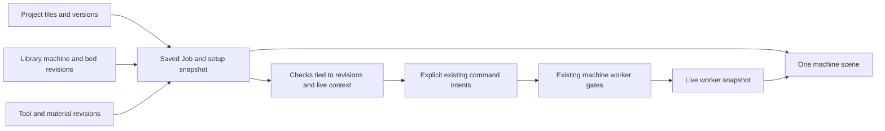

# One Job view, with project files and a persistent setup

Analysis for the owner, 2026-11-03. Source baseline: Run main `4f75f95f27c60f8c8c766fea124d7f650020ed48`; design baseline: `JOB_WORKFLOW.md`, `PROJECTS.md`, `WORKSPACE_FEATURES.md`, and `redesign-plan:docs/design/REDESIGN.md` plus its Job/Library mock-up sources. Analysis only: no application edits, no serial ports, no live machine actions. File references below are relative to `/Volumes/External/projects/run`.

**Recommendation: merge Setup and Run into Job, keep one scene visible throughout, and make a saved Job the link between a project's files, a machine, and its setup.** Projects is the cabinet; Library holds reusable equipment and material definitions; Job is the bench; Board is controller configuration. The existing redesign has the right screen arrangement. It needs the missing data ownership and file-to-geometry flow before cosmetic work can make it coherent.

## 1. What the code actually does today

| State | Current owner and persistence | What crosses the view boundary |
|---|---|---|
| Selected machine | `workspace/library.ts:116,152,348`: `MachineProfile`, `machineStore`, `selectedMachineStore`; localStorage | Machines updates it; the shell displays its name. Run's preview and Setup's scene do not consume its geometry. A project can record a separate machine reference. |
| Bed | `library.ts:129,176`: the single `setupStore.bed`, initially 790 × 790 × 19 | Setup edits it. It is not part of a machine profile, and selecting another machine does not replace it. |
| Stock/material | `setupStore.stock`, `@synthetos/library` Stock, localStorage | Setup edits dimensions, shape, material reference, XY position and a corner/top-bottom zero choice. Projects can copy a description of this stock, not its geometry. |
| Fixture/clamps | `setupStore.fixture` and boolean `clamps` | Setup imports one DXF/SVG outline and holes, with height and XY. Clamps are four illustrative boxes generated from stock edges, not individually placed records. |
| G-code and preview | `preview/PreviewPanel.ts:94`: component state, last File and gcode worker | Run has the file picker and samples. `workspace/fileBridge.ts` accepts a bare File from Projects and publishes checked bytes for reporting. The project/file ID, role, setup and machine are lost in that handoff. |
| Planned zero used by Start | `workspace/jobUi.ts:104`: `run.ws.job-plan.<fileKey>` | `JobViews.ts:112` records the **board's current effective offset** as a file plan. It does not read Setup's chosen stock corner. The record has no job, machine or WCS identity. |
| Actual controller state | `workspace/model.ts`, `live/mount.ts`, worker snapshot | One document-lifetime session provides positions, offsets, homing, settings and job state. Board and Run consume it. It survives view changes and must remain the authority for commands. |
| Project | `projects/store.ts:23–79`, IndexedDB records/blobs via `workspace/storage.ts` | Files, SHA-256, roles, notes, images, links, descriptive setup refs. There is no persistent Job entity or run-history field in this Project shape. |
| Tools/material library | `library.ts`, `views/LibraryViews.ts` | Tools and Materials are separate rail views today. Setup consumes material selection; tool-change labels look up tool numbers. Selecting a tool does not generate CAM or rewrite G-code. |
| Controller configuration | `views/BoardView.ts`, `workspace/settings/*` | Machines can stage compatible profile fields in Board's Pending changes. Apply/backup/read-back are explicit existing actions; selecting a profile does not configure the controller. |

`AppShell.ts:210,248` keeps all ten view components mounted and toggles `hidden`. Navigation normally preserves local component state, but this is not a shared setup model. There is currently no combined Library screen.

### Actual user paths and the breaks between them

1. **Projects → New project → Choose files/drop.** This already works locally, including images, description and links. Limits: G-code 50 MiB, other files 20 MiB, image originals 10 MiB, project 500 MiB. Images are re-encoded to WebP. Sharing is disabled pending accounts.
2. **G-code → Open in Run.** `ProjectsView.ts:164` gets a blob, creates a new File and calls `openInRun`. `RunView.ts:81` consumes it. The project's "Cut with" selections do not activate the selected machine or restore Setup.
3. **Drawing → no setup action.** DXF/SVG files can be stored and labelled Drawing, but cannot be used directly as stock, fixture or bed. Setup has a separate picker, so the user must choose the original file again. Its parser cap is 4 MiB, smaller than Projects' 20 MiB storage cap.
4. **Machines → Make my copy/select → Board.** Profile selection supplies the shell label and a settings comparison. It supplies neither scene's bed. Machines can stage settings; Board owns the reviewed write.
5. **Setup → Run.** There is no transfer. Setup's stock, clamps, fixture, bed and zero marker never enter Run's preview or job check.
6. **Run → project history.** No automatic save of the opened file, prepared job, setup snapshot or result exists. "Cut with" is manually entered documentation.

### The two scenes disagree about both content and coordinates

| Run preview | Setup scene |
|---|---|
| WebGL2 through `Preview3D.ts` and `packages/gcode-view/src/renderer.ts`; SVG fallback | Canvas2D projected solids in `workspace/setupScene.ts:49` |
| Sanitized toolpath segments, rapid/feed distinction, source lines, findings, scrub, breakpoints, executing/queued overlays | Bed slab, stock solid, one fixture outline/holes, four illustrative toe clamps, selected stock-corner zero |
| Offline pipeline assumes G21/G90/G17, zero position and offsets; `pipeline.ts:118,218` always returns `envelope: null` | Bed top is scene Z=0; stock and fixture XY positions are **centres**, despite generic Position labels; fixture height is used as the stock support height |
| Renderer has envelope/origin APIs, but the current pipeline does not feed it the selected machine's envelope or the live job's geometry | Does not read a file, selected machine travel, actual board offsets or live tool position |
| Live marker is in work coordinates; worker checks the job again with actual board state separately | Height labels add bed thickness to report heights above the table; no measured table/bed-to-machine transform |

Run's scene is therefore not a physical placement check even when a machine name appears above it. Setup's "Sits on the fixture" checks width, not full containment, support or clamp clearance (`SetupView.ts:116`). Its own notice correctly says it is an illustration, not a collision check.

### Duplicated and unfinished paths to retire or connect

- Three unrelated meanings of setup: the global SetupState, ProjectSetup's descriptive refs, and the worker's transient checked job. Keep their distinct responsibilities but connect them through a durable Job record.
- Two unrelated planned zeros: Setup's stock reference and the file-keyed copy of board `ofs`. Neither should silently overwrite the other.
- Two file-entry paths: Run's picker and Projects' blob handoff. Route both through the same job-opening operation. Run's picker disables during an active job, but `RunBridge` does not check `ui.active`; Projects can replace the visible preview while the worker continues the old job. The shared opener must enforce the active-job lock.
- Two renderers, cameras and fit controls. Port Setup geometry into the toolpath renderer, including its fallback, then retire SetupScene.
- `PreviewView`'s standalone layout is an alternate supported entry point, not simply dead code. Keep it as a consumer of the same preview engine; remove only duplicated workspace chrome.
- Analyze is explicitly a placeholder (`OtherViews.ts:19`), overrides are mock controls, firmware updating is a future panel. Do not promote their proposed abilities to completed checks.
- Several design/mock-up strings still say Phase 1/no jobs; main already implements gated P2/P3. Derive availability from current worker capabilities rather than copying those labels.

## 2. The intended walkthrough: an X-Carve and a part to cut

Assume an X-Carve fitted with a controller/firmware this build supports. Selecting an X-Carve preset describes mechanics; it must not imply that every controller fitted to an X-Carve is supported. The walkthrough uses an existing CAM-generated file, not SVG-to-toolpath generation.

"None" in the board column means the action sends no new board command; an already connected session can still receive reports and perform its established safety/read maintenance. Existing motion/jobs remain gated by build, controller approval and worker state. The Run review's R1–R8 fixes are prerequisites for relying on the affected motion paths.

| Step and screen | Click and result | Board action | Status on reviewed main |
|---|---|---|---|
| 1. Projects | New project; name it "Mounting plate". A file area and empty Jobs list appear. | None | Project creation exists; Jobs list missing. |
| 2. Projects or Job's Files panel | Add `plate.nc`, `fixture.svg`, `stock.dxf`, `spoilboard.svg` and reference photos. Each gets a role, size and version/hash. Photos remain references. | None | Uploads/photos exist. Geometry usage and immutable file-version workflow missing. |
| 3. Project → New job from `plate.nc` | Open Job with a file name, project breadcrumb and five steps: Machine → Stock & workholding → Place → Check → Run. The same scene stays visible. | None; offline parse/check only | Bare Open in Run exists; saved Job and unified scene missing. |
| 4. Job → Machine | Choose machine → X-Carve preset → Make my copy → name it "Shop X-Carve". Check travel and bed dimensions against the actual machine; unverified dimensions say Placeholder. | None | Copy/profile editing exists in Machines. Machine-owned bed, sourced pattern and in-flow picker missing. |
| 5. Machine → Bed | Select `spoilboard.svg` from Files → Use as bed drawing. Confirm units, scale and a known measured dimension; enter thickness and locate it relative to machine home. Save this bed revision to this machine. | None | Missing. Existing fixture parser is reusable for a limited outline, not a full CAD interpreter. |
| 6. Job → Stock & workholding | Choose Block/Sheet or Use `stock.dxf` as stock outline; enter thickness/material; place it using numbers or drag. Use `fixture.svg` as fixture, set height and position; place actual clamps. Scene shows the height stack and selected object's reference point. | None | Rectangular/round/sheet stock and one fixture work in Setup. Arbitrary stock outline, project picker, real clamp placements and unified scene missing. |
| 7. Job → Place | G-code is already on the bed. Choose its CAM datum, e.g. front-left/top. Centre on stock or drag the **planned work zero**. Stock stays where the user placed it unless "Move stock and job together" is explicitly selected. Show dimensions and travel fit. | None; never rewrite/send G-code while dragging | Missing. Current zero picker is illustrative, and Record plan copies board state only. |
| 8. Job → Check, offline | Inspect file findings, tool numbers, planned extents and required clearances. Click Show to highlight a line/object. Unsupported checks say Not checked with a reason. | None | File sanitizer/list exists; stock/clamp/travel checks against this setup missing. |
| 9. Persistent machine strip → Connect | Choose and confirm the actual controller. Show identity, capability, actual position, homing and settings differences beside the planned machine. If commissioning is needed, open Board and return to the same Job. | Existing consent/identity/read flow; existing approved report-list/heartbeat setup where applicable. No automatic home or profile application. | Connection and explicit Board apply exist; unified placement comparison missing. |
| 10. Job → Check/Run preparation → Home | After checking switch configuration and the physical machine, explicitly confirm Home. Watch homing state update. Home and Set work zero remain separate actions. | Existing `home` RPC; worker generates `G28.2` for named axes and confirming reads | Exists on eligible builds; needs integration into the step. No serial commands were exercised in this analysis. |
| 11. Job → Place/prepare zero | Jog to the physically chosen datum using the existing jog controls. Confirm Set X/Y zero and separately set Z using the user's actual touch-off method. Show planned versus board zero; allow an explicit "Use measured zero as plan" if the physical stock placement differs. | Jog RPC uses short G-code pieces; release follows existing hold/flush procedure. `setZero` sends `G10 L20 Pn ...0`, with read-back, after C16. | Jog/set-zero exist. No automatic probe or safe arbitrary "Jog to planned point" workflow exists. Reuse manual actions first. |
| 12. Job → Check again | Recheck against current units, offsets, position, board limits and current file/setup revisions. Show the actual-board placement beside the plan; resolve mismatches. Homing/zeroing can invalidate earlier checks. | Read-only confirmation as needed; worker sanitizer, no file streaming | Worker live check exists, but stale-result invalidation is R3; scene-aware check fingerprint missing. |
| 13. Job → Run → Start job | Review existing confirmations and exact safety text, including attendance/spindle/work zero as applicable, then C30. Scene stays on the same bed; panels change to progress and live position. | Existing worker preparation/line-mode path, then sanitized numbered job lines | Gated streaming exists. Unified scene and complete immutable job snapshot missing. |
| 14. Running/paused | Fixed strip offers Pause/Stop job everywhere. Pause reports its actual state; the user resolves a refusal or stop point explicitly. Browse project files without replacing the active job. | Existing Pause `!`; Stop uses the worker hold-confirm/flush/output-off/restore sequence; Resume only through worker gates | Core controls exist; flow must preserve them. R4/R5/R6 fix edge cases. |
| 15. Job → tool-change state | See current/next tool, verified shutdown progress and the existing stop card. After the physical change, use permitted jog/Z re-zero, then C34 and C35 if required. | Worker drains at stop; M5/M9 must be acknowledged; permitted motion; worker owns any return path, tool selection and continued streaming | Existing tool-change UI exists; R1/R6 fixes required. Tool-length probing is not implemented. |
| 16. Finish | Wait for the worker's completed state. Save outcome, immutable file/setup/tool versions, elapsed time and notes into this Job's history. Offer Run again as a new checked execution. | Existing completion/output/line-mode restoration; no new automatic park, home or repeat | Status exists; durable history and reproducible job reopening missing. |

For a quick one-off file, allow "Open G-code" directly in Job and create a recoverable local draft with "Save to project". Do not require project metadata before a user can inspect a file.

## 3. One Job model and one scene

Use the redesign's five-step bar across the top; the left panel edits the selected step, the centre is the scene and G-code dock, the right panel holds actual machine position and relevant controls. Steps can be revisited without commanding anything. Start has one stable location. A separate persistent Files drawer is available at every step; files should not become a sixth wizard step.

**Ownership:** a project contains files and multiple jobs; a machine revision owns its bed, home-frame convention and measured bed transform; a job owns its source file version, machine revision, stock, fixture instances, clamps, tool mapping and planned WCS placement. An execution references an immutable job snapshot and the actual board identity/settings context. Homing, consent, live offsets and permission to resume remain session/device facts and are never restored from a project.

A minimal Job record needs `id`, `projectId?`, `revision`, `fileRef{id,hash}`, `machineRef{id,revision}`, `setupSnapshot`, `placement{wcs,datum,plannedZero,frame}`, and tool/material version refs. Check results carry the exact revisions and live context that produced them; results are invalidated when those inputs change. Use existing Project SHA-256 identity rather than promoting the current FNV file key into a durable identity.

**File entry:** adding files stores them first; it does not start a job. "Use in Job" has an explicit role menu: G-code, stock outline, fixture, bed drawing, reference. Drawing import shows a geometry preview, units/scale and unsupported-entity notice before accepting. Preserve the original file and its hash. A bed change offers Save to machine revision; a fixture/stock change belongs to this job. A photo never becomes scaled cutting geometry. STL/STEP remain stored reference files until there is an actual importer. Dropping on the scene is a shortcut to this same import flow, not a second implementation.

**Coordinate contract:** put the shared scene in machine coordinates. Represent bed geometry with an explicit bed-to-machine transform; do not treat bed top as machine Z=0 or confuse table-relative heights with machine Z. Preserve existing Setup centre semantics during migration and label them. The placement datum describes the CAM file's origin; a front-left selection does not prove the file was programmed that way.

For a simple G54-only file with no internal offset changes, planned machine position is work position plus the planned effective offset. For board placement use the controller's actual active coordinate system, G92/tool offsets and units. Do not offset the entire path blindly: G53 moves, G54–G59 changes, incremental moves and internal offset-setting lines require replay through the motion model. Initially mark unsupported placement cases read-only/unverified rather than offer an inaccurate drag transform. Keep original bytes unchanged; rotate/mirror/array are later explicit derived file versions.

Show plan and board as labelled layers, including stale/unknown status. A green travel result means only the named geometric check passed. Clamp drawings cannot justify "collision free" without cutter/holder geometry and a real collision implementation. Likewise controller spindle state is not proof of physical zero RPM.

**Active execution:** freeze the execution's file, setup and placement through running, draining, paused, refused and tool-change phases. Browsing another project is fine; opening another active job must be refused or explicitly queued as a future draft, never swap the preview under the current progress marker. Keep permissible tool-change jog/Z operations under the existing worker state machine. Navigation never disconnects or creates another worker.

## 4. Minimal implementation sequence and redesign differences

| Order | Change and files | Acceptance evidence |
|---|---|---|
| 1 | Add versioned Job/setup records and a document-lifetime active-job store: new `workspace/jobModel.ts`, `projects/store.ts`, `workspace/storage.ts`, `workspace/library.ts`. Migrate old global setup as an explicitly named draft; keep the original until successful persistence. | Two projects with different setups reopen correctly; quota failure preserves old data; no live safety facts restored. |
| 2 | Replace the bare File bridge with one job opener carrying project/file/version identity: `fileBridge.ts`, `ProjectsView.ts`, `RunView.ts`, `PreviewPanel.ts`. Enforce active-execution lock centrally. | Open file from either entry and get identical job identity; Projects cannot replace a paused/running job's preview; old execution bytes remain available. |
| 3 | Add machine-owned versioned bed and frame, with sources/placeholder status: `library.ts`, `machineDrawings.ts`, `MachinesView.ts`, library schemas if moving the local profile into the package. Add Files role actions using `outline.ts` and `SetupView.ts` logic. | Changing selected machine changes the intended bed only; old jobs keep pinned geometry. Unsupported/oversize drawing import reports the correct reason without losing the stored file. |
| 4 | Build the shared scene model and renderer layers: new `preview/sceneModel.ts`, `Preview3D.ts`, `PreviewSvg.ts`, `packages/gcode-view/src/renderer.ts`, camera/geometry helpers. Port Setup solids; keep toolpath chunking and planner overlays. | Bed/stock/path agree in Top and 3D, including negative coordinates and Z transform; fallback remains useful; large-file performance checked. Retire `setupScene.ts` after parity. |
| 5 | Assemble Job and grouped Library: new `views/JobView.ts`/step panels/Files panel, extract existing `RunView.ts`, `SetupView.ts`, `JobViews.ts` controls, update `AppShell.ts` and styles. Preserve the current strip and session owner first. | View switching retains camera/file/worker; all current motion and warning controls remain classified; same Pause/Stop location across screens. |
| 6 | Implement planned placement, board comparison and revision-aware checks: new pure placement module, `jobUi.ts`, `gcode-worker/pipeline.ts`/client data contract, `JobViews.ts`, existing worker load/check contract as needed. Coordinate with the R1–R8 fix branch. | G54/G55, G92, G53, inch units, bed-frame Z and changed-file cases; home/jog/offset/settings changes invalidate checks. Correct geometry never grants command authority. |
| 7 | Save execution history and reopen/repeat: `projects/store.ts`, active-job store, existing job snapshot subscription. Add completion notes and immutable setup references. | Refresh restores a draft/history, never resumes motion. Re-run requires a new live check. |
| 8 | Apply approved visual tokens, responsive layout and screenshot review from redesign-plan. | 1280/1440/1920/390 in both themes, warning/paused/tool-change/observer states; keyboard focus, no document scroll, CSP and safety gates. |

This is a sequence of reviewable increments, not one renderer rewrite. The useful first vertical slice is: **project G-code → job with machine and bed → stock → toolpath on the same bed → reopen intact**, followed by placement/live comparison and execution integration.

Differences to resolve in `REDESIGN.md`:

- Keep its one Job, horizontal steps, Library grouping and single scene. Add persistent Job ownership and Files import before its shell-only placeholders; colour changes alone do not fix today's data disconnect.
- Its Projects empty state says projects arrive with accounts. That is obsolete: local Projects already ships. Preserve those features and storage limits.
- Its Phase 1 disabled-motion descriptions are stale relative to main. Reuse current capability gates and C30–C36 flow; do not introduce another start procedure from older C7 prose.
- Its implementation list omits the `packages/gcode-view` renderer extension needed for actual bed/solid layers. `Preview3D` currently wraps a renderer, not a general solid-scene engine.
- Treat clamp collision checks, precise preset mounting patterns, automatic Follow camera and operations/removed-material rendering as explicit follow-on features. None should delay the file/setup connection or be displayed as already verified.
- Its frame change moves Pause/Stop vertically. Defer that until the separate safety/layout review; the functional merger can leave their current strip untouched. Preserve all SAFETY strings and Pause/Stop rules, including Escape behavior.

## 5. Owner decisions, with recommendations

1. **Require a project before opening G-code?** No. A recoverable local draft supports one-off work; Save to project preserves it when wanted.
2. **One file or many per job?** One executable G-code version per initial job; any number of reference/setup files. Multiple files become separate jobs/operations later, with explicit ordering.
3. **Does dragging move stock or the cutting origin?** Place step drags planned zero only. Stock step drags stock. Moving both is an explicit linked selection, never inferred.
4. **Where does a custom spoilboard live?** As a machine bed revision, selected/pinned by each job. Do not let revising a library machine silently change an existing job.
5. **What should drawings do in the first release?** Keep arbitrary files; import supported outline geometry with a units/scale check. Fixture and bed first; add stock-outline support deliberately. Do not imply CAD/CAM from upload.
6. **How should the plan become physical?** Manual jog/touch-off and the existing confirmed Set zero actions first. "Jog to planned point" and automatic probing need their own reviewed motion designs.
7. **Where are authoritative X-Carve bed dimensions obtained?** Manufacturer drawing or owner measurement, recorded with provenance. Until verified, show Placeholder and exclude unsupported certainty from fit checks.
8. **Prioritize workflow or restyling?** Workflow and the shared model first, adopting the approved visual system as each touched panel moves. Keep the old start/stop machinery intact while consolidating screens.

The deliverable is source-based analysis, not a new usability test or a claim that proposed geometric checks already exist. No implementation was requested or performed.

