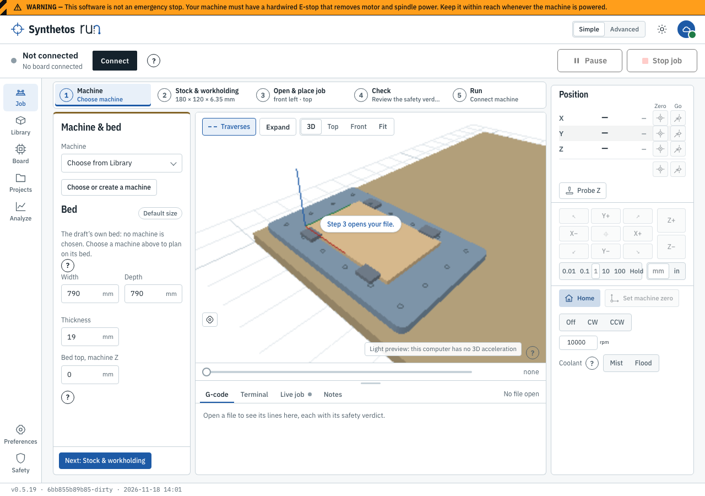
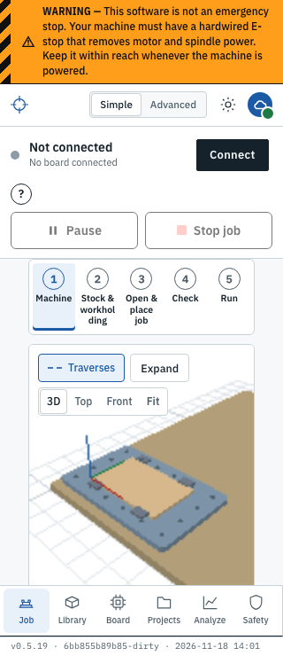
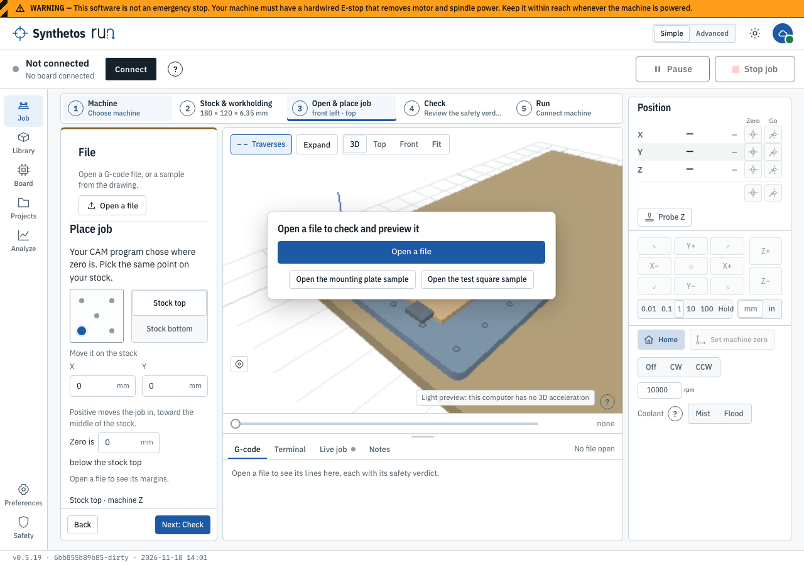
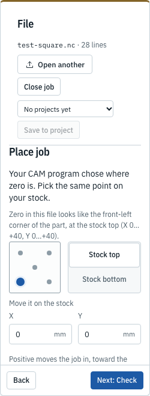
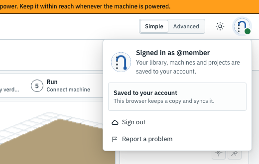
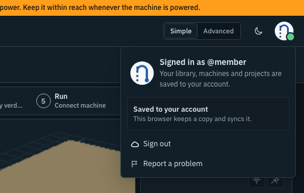

# The Job page cleanup and the account picture

Slice 3 of the first-run design (`docs/superpowers/specs/2026-11-16-first-run-design.md` §7), plus one thing the
owner asked for on 2026-11-18: the GitHub picture of the signed-in account in the top-right button.

## What a visitor sees

- **The Job page opens on the five steps.** The bar that used to sit above them ("No file open", Files, Open project,
  Open a file, and the "Draft setup · local draft · no machine · bed …" line) is gone. Machine → Stock & workholding →
  Open & place job → Check → Run are the first thing under the machine strip.
- **The file lives at step 3.** "Open & place job" starts with a small File block: the picker, and once a file is
  open its name and line count, Open another, Close job, and Save to project for a draft. At steps 1 and 2 the drawing
  says "Step 3 opens your file"; at step 3 the drawing offers Open a file and the two samples, as before. Projects and
  their files are opened from the Projects view in the left rail. Once a file is open, its name, its project line and
  Close job follow you to every step, so a job finished at step 5 is closed right there; the picker stays at step 3.
- **Step 4 says what Check does.** Its hint is "Review the safety verdict" until a file is checked, then the verdict
  (File checked, Review findings, Blocked).
- **The footer is the version.** "Review settings before applying" and "Libraries saved in this browser" are gone.
- **No repeated reassurance.** The account menu no longer ends with "Pause, Stop job and the other stop controls never
  need you to be signed in"; the Connect notice no longer says "Pause and Stop job never need an account"; the bed
  section no longer says "Saved in this browser." The warning bar and /safety say the stop rules once. The menu's sync
  row ("Saved to your account" / "Saved in this browser") stays: it is state.
- **The account button shows the GitHub picture** when signed in, round, 32 px in the bar (28 px on a phone) and 40 px
  at the head of the open menu. Signed out, or when the picture cannot be loaded, the cloud icon shows as before.

## How the picture gets there

The page's CSP is `img-src 'self' data: blob:`, so the browser never asks GitHub. The account menu renders
`` and the run Worker answers it (`workers/run/src/avatarRoute.ts`):

| Rule | Value |
|---|---|
| Who | a validated run session, else 401 |
| Which picture | the session's GitHub identity id, numeric only: `avatars.githubusercontent.com/u/<id>?s=96&v=4` |
| How | server-side `GET`, `redirect: 'manual'`, 10 s timeout, 256 KB cap |
| What is served | `image/png`, `image/jpeg`, `image/gif`, `image/webp` from a 200; anything else is a detail-free 404 |
| Caching | per GitHub id for a day on the Worker (Cache API); the answer is `private, max-age=86400`, `vary: Cookie` |
| Headers | the same security-header seam as every Worker response (`index.ts`) |

The upstream literal is the reviewed entry for `avatarRoute.ts` in `tools/gates/src/source/workerUpstreams.ts`.

## Screenshots

Generated by `tools/e2e/specs/job-page-cleanup.e2e.ts` and `tools/e2e/specs/connect-role.e2e.ts` with `RUN_SCREENSHOTS=1`.

The Job page as it opens, signed in, 1280 px and 320 px:

Step 3 before a file is open (the File block on the left, the drawing's prompt in the middle), and the File block
with the test square sample open:

The account button with the picture (the test stubs `/api/avatar` with the tab icon), light and dark:

The open account menu:

| Light | Dark |
|---|---|
|  |  |

## Tests

- `apps/web/test/fileBlock.test.ts`: the File block at step 3, hidden elsewhere until a file is open and then showing
  the name and Close job on every step, the picker always in the tree, Save to project.
- `apps/web/test/jobPageText.test.ts`, `apps/web/test/accountMenu.test.ts`: the removed lines, the step 4 hint, the
  picture in the button and the menu head, the fallback to the icon.
- `workers/run/test/avatar.test.ts`: 401 without a session, 404 without a GitHub identity, the PNG proxied, html, a
  redirect and an oversized body refused, the cache, the handler's security headers.
- `tools/e2e/specs/job-page-cleanup.e2e.ts`, `tools/e2e/specs/connect-role.e2e.ts`: the built page.
