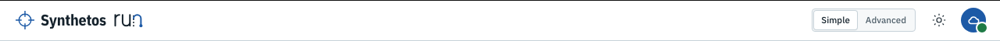
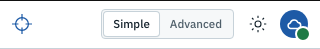
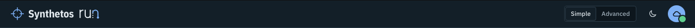
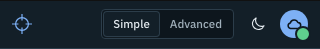
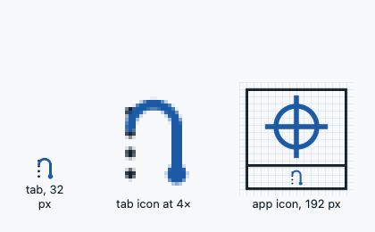
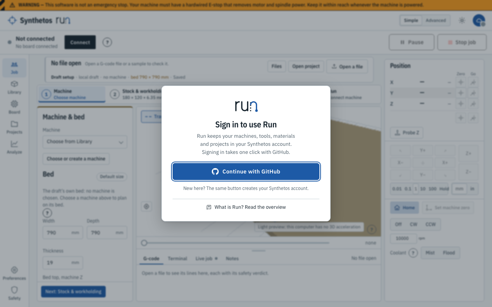

# The logo placements

The run wordmark is a monoline lowercase "run" whose `n` is a toolpath arc move: a dotted rapid up the left stem,
the blue feed arch and right stem, the blue tool at the end. Slice 1 put it in the sign-in dialog. This slice puts it
everywhere else the design names (`docs/superpowers/specs/2026-11-16-first-run-design.md` §4): the top bar, the tab
icon and app icons, standalone SVG files and the README. The accounts site and the forum keep their own marks;
synthetos.com follows in slice 5.

## What a visitor sees

- **Top bar.** The crosshair, "Synthetos" and the wordmark, one link home. The wordmark's x-height sits on the cap
  height of "Synthetos". Its letters are ink and its arc is `--blue`, so it follows the theme. On a phone (narrower
  than 650 px) the wordmark hides, as the grey "Run" text did before it; on a narrow phone (400 px and under) the
  name hides too and the crosshair alone stands for the brand, so the level switch, theme toggle and account button
  fit on screen. The link is named "Synthetos Run" at every width.
- **Tab icon.** The `n` alone on paper. The 192 and 512 px app icons keep the drafting-paper composition and carry the
  `n` in the title block where "RUN" was. The maskable and monochrome icons follow suit.
- **README.** The wordmark at the top, the dark file when GitHub is in its dark theme.
- **Sign-in dialog.** Unchanged: the wordmark alone above "Sign in to use Run".

## Where each asset lives

| Asset | File | Source of its numbers |
|---|---|---|
| Geometry | `apps/web/src/brand/wordmarkGeometry.ts` | the spec; the single source, imports nothing |
| Wordmark component | `apps/web/src/brand/RunWordmark.ts` | geometry; `currentColor` and `var(--blue)` |
| Top bar lockup | `apps/web/src/brand/BrandLockup.ts` | the component above at 27 px, labelled "Run" |
| `run-wordmark.svg`, `run-wordmark-dark.svg` | `apps/web/src/brand/` | `pnpm gen:brand` from the geometry and `tokens.css` |
| `run-mark.svg`, `run-mark-dark.svg` | `apps/web/src/brand/` | same; viewBox `40 12 24 32` around the `n` |
| `icon-32.png`, `icon-192.png`, `icon-512.png`, maskable, monochrome | `apps/web/public/icons/` | `pnpm gen:icons`; `tools/gates/src/icons/mark.ts` parses the `n` paths into dots, a ring and a stroke |

The standalone files cannot read CSS, so there is one per theme with the literal `--ink` and `--blue` of that theme.
The unsuffixed file is the light theme, the `-dark` file the dark theme. Changing either token in `tokens.css` fails
`tools/gates/test/brand-svg.test.ts`, which pins the four hex values and compares the files with a fresh render: run
`pnpm gen:brand` and update the pinned values in that test. `manifest.test.ts` does the same for the PNGs, cured by
`pnpm gen:icons` (its colours are checked against `tokens.css`, not pinned).

## Screenshots

Generated by `tools/e2e/specs/logo-placements.e2e.ts` with `RUN_SCREENSHOTS=1`.

| | 1280 px | 320 px |
|---|---|---|
| Light |  |  |
| Dark |  |  |

The tab icon at 32 px, the same at 4× and the 192 px app icon:

The sign-in dialog, unchanged, under the new top bar:

## Tests

- `apps/web/test/brand.test.ts`: the component draws the geometry; the lockup is one link named "Synthetos Run" with a
  hidden crosshair and the wordmark in place of the grey text; the geometry module imports nothing.
- `tools/gates/test/mark.test.ts`: the icon renderer's `n` is parsed from the same path strings the SVG uses, with the
  spec's numbers (stem 44, arch centre (52, 24) r 8, dots at y 40, 32.85, 25.7, 18.55); the 32 px icon is ink dots
  left, blue right, paper around.
- `tools/gates/test/brand-svg.test.ts`: each committed SVG equals a fresh render; colours equal the theme tokens.
- `tools/gates/test/manifest.test.ts`: each committed PNG equals a fresh render; maskable safe zone; monochrome.
- `tools/e2e/specs/logo-placements.e2e.ts`: the lockup in both themes, hidden wordmark at 320 px, the icon link, the
  icons render, the dialog still shows the wordmark alone.
