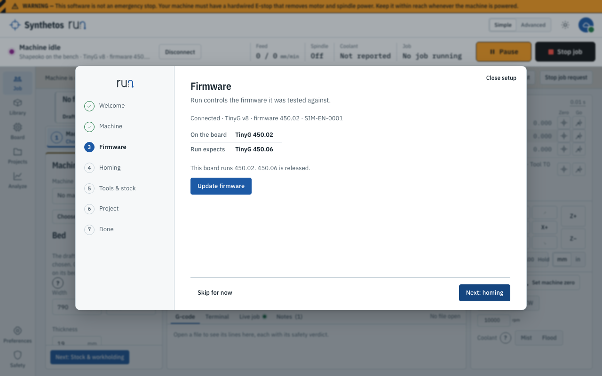
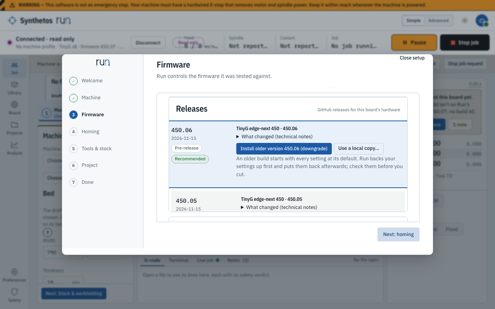
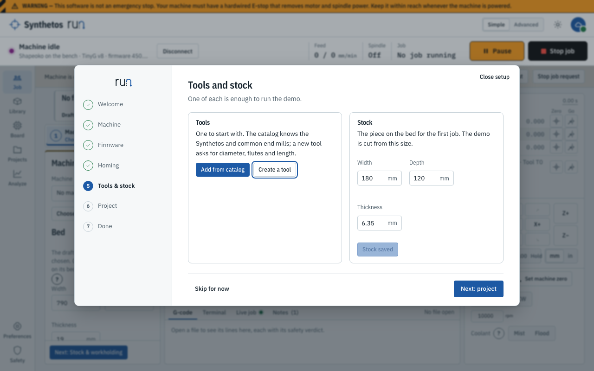
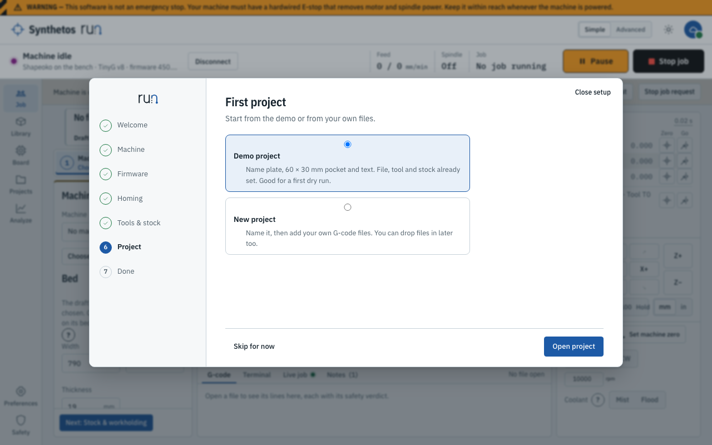
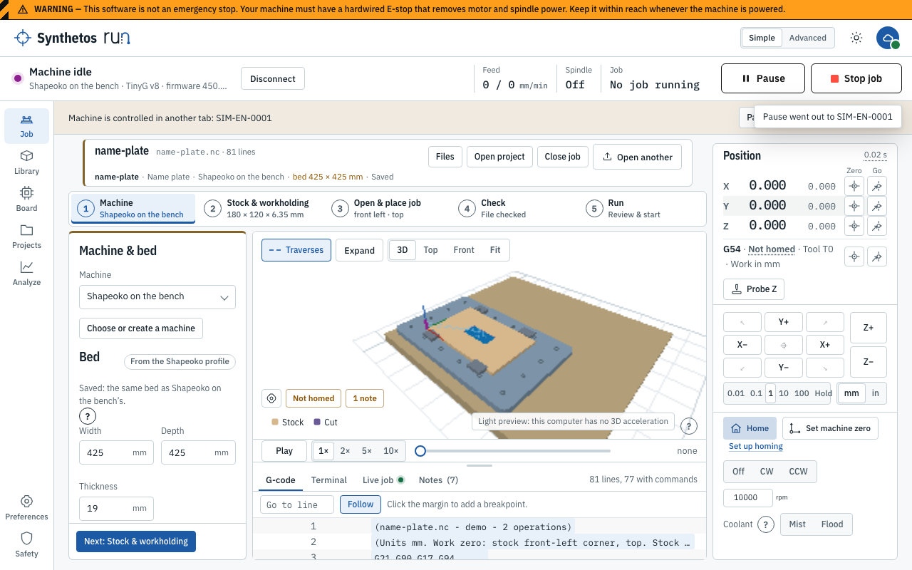
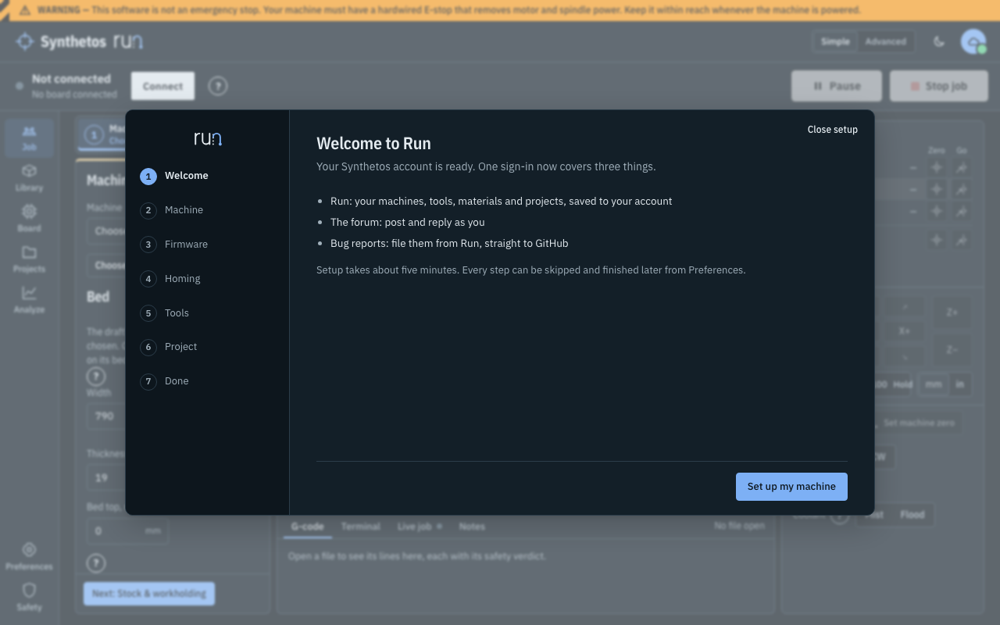

# The setup wizard

A signed-in account with no machine is met by one dialog over the dimmed workspace: the run wordmark, seven
numbered steps down the left, one job per screen. Welcome, your machine, firmware, homing, tools and stock, a first
project, done. Every step but the first and the last can be skipped. Progress lives in the account, so the wizard
resumes where it was left on any browser. It ends with the demo name plate open on the Job page. Design:
`docs/superpowers/specs/2026-11-16-first-run-design.md` §6; plan and rulings:
`docs/superpowers/plans/2026-11-18-setup-wizard.md`.

**Every picture below is simulated**: the fake-serial test build drives a simulated TinyG board, and the account is
an in-memory stub of the record service. No bench hardware was used. The firmware `needed` shot uses the simulated
unapproved board (450.07 on hardware 8), the same case `firmware-offer.fake-serial.ts` exercises. Opening the port
from the test harness leaves the tab an observer, which is why the Job page shot says "controlled in another tab"; a
person who connects from the wizard never sees that.

## What a first-time user sees

| Step | What happens | |
|---|---|---|
| 1 Welcome | What the account now covers and how long setup takes. Focus starts on the heading; Tab reaches the primary. |  |
| 2 Your machine | A machine template, a name (300 px), the bed's three sizes (96 px plus mm), then the existing Connect flow. Once connected the line shows the board and its id; Next saves the machine record bound to that board. |  |
| 3 Firmware | The board's build against the newest release Run supports, decided by `firmware/updateOffer.ts`. Here the simulated board runs 450.02 and 450.06 is released: skippable, Next on. |  |
| 3 Firmware, needed | Below what Run controls: no Skip, Next held, the exact offer text, "Update firmware". |  |
| 3 Firmware, updating | "Update firmware" runs the Board tab's own update flow inside the frame with the offered release marked. The flash itself is the existing flow, unchanged (`flasher.fake-serial.ts` covers it). |  |
| 4 Homing | Two radio cards; the choice is written to the setup record as it is made and never to the board. Homing moves the machine and Pause and Stop sit under the wizard's lock, so the wizard never offers Home: with switches it points to the Job page; without switches it shows the existing Set machine zero control (no motion). |  |
| 5 Tools and stock | Add from catalog (the catalog picker, in place) or Create a tool (the tool editor, on top); the stock's three sizes, saved to the setup record by Add stock. |  |
| 6 First project | The demo name plate, or a new project by name. Open project makes the demo as a real project in the account and opens its file. |  |
| 7 You are set | The project that is open, one line on what to do next, and the "More to set up" rows, each collapsed with a link to the place in Run where it is done. |  |
| The Job page | After "Go to the Job page": the name plate open, stock 180 × 120 × 6.35 mm, the machine and bed from step 2. |  |

Dark theme, first and last step:

| | |
|---|---|
|  |  |

Below 1024 px the frame is full-screen and the rail collapses to seven dots and the current step's name:


## Where things live

| Piece | File |
|---|---|
| The record kind `setup` (one document per account, id `setup`) | `packages/library/src/setup.ts` (reader), `packages/contracts/src/records.ts`, `workers/run/src/limits.ts`, `workers/run-data/src/store.ts`, `workers/run-data/migrations/0004_setup_records.sql` |
| The record on the page: view signal, writer, default stock | `apps/web/src/workspace/cloud/setupSync.ts`, wired in `librarySync.ts` |
| Open, resume and rail rules (pure) | `apps/web/src/wizard/wizardState.ts` |
| Frame, rail, mount, actions | `apps/web/src/wizard/WizardFrame.ts`, `WizardRail.ts`, `SetupWizard.ts`, `setupActions.ts`; styles `apps/web/src/styles/wizard.css` |
| One file per step | `apps/web/src/wizard/steps/{Welcome,Machine,Firmware,Homing,ToolsStock,FirstProject,Done}.ts` with their pure helpers `machineDraft.ts`, `firmwareStep.ts`, `homingStep.ts`, `stockFields.ts` |
| The demo project | `apps/web/src/wizard/demoProject.ts` (program, tool, stock, setup), `createDemo.ts` (writes and opens) |
| "More to set up" rows | `apps/web/src/wizard/moreTopics.ts`; how they seed help articles: `docs/design/HELP_SYSTEM.md` |
| "Run setup again" | Preferences, `apps/web/src/workspace/views/OtherViews.ts` |
| The shell hook | `AppShell.ts` renders `SetupWizard` beside `SignInGate`; `gate/useShellLock.ts` locks the app for either |

## What the wizard writes

Only account records, through the paths that exist: the machine (with `boardId`), the tool entry, the project with
its file and setup, and the setup record itself (`dismissed`, `step`, `done`, `homing`, `stock`, `toolId`,
`machineId`, `projectId`). Nothing goes to browser storage; nothing is written to the board.

## Rulings made while building

| Ruling | Cost if wrong |
|---|---|
| The wizard opens when signed in, after the first record read, with no dismissal, and either no machine record or a setup record at all (a started wizard, or "Run setup again"). A legacy account with machines and no record never sees it uninvited. | A started wizard shows on every load until finished or closed, which is the resume behaviour the spec asks for. |
| The homing choice lives on the setup record; the board is never written. | None: owner's decision 2026-11-17. |
| The wizard never offers "Home": Pause and Stop are in the machine strip under the wizard's lock (SAFETY §4.1). With switches the step points to the Job page; without switches it shows Set machine zero, which does not move the machine. | The spec's "Home now" waits for the Job page; a slice that keeps the strip outside the lock could bring it back. |
| "Update firmware" embeds the Board tab's whole update flow in the frame. While the flash runs, or while the update was started and the session is closed, the step is `updating`: no Skip, Next held, the flow stays on screen. Next unlocks when the board is back and the offer is no longer `needed`. | A cramped layout in the content column; it scrolls. |
| Steps 3 and 4 name the connected board and refuse another board than the machine's with one line; step 3 then hides "Update firmware" and holds Next. | None visible. |
| A refused "Open project" (a running job, a missing file) still records the project it made; the next press opens that project instead of making another. | None visible. |
| Closing is a quiet "Close setup" button; Escape does nothing. Preferences brings it back at step 1. | One extra button. |
| The chosen tool is the entry added while step 5 is open; the stock is written when Add stock is pressed. | A tool added elsewhere during the step counts as the choice. |
| The demo tool is defined in code with the catalog's values (id `demo.quarter-2f`); the catalog is not fetched. | A duplicate of one catalog row. |
| There is no new-project dialog in Run; "New project" takes a name in the card and creates it the way Projects does. | None visible. |
| The setup stock becomes the default stock of new draft jobs until a project uses it. | One computed read in `jobModel.ts`. |
| A conflict on the setup record keeps the account version and drops the local write (the record has one id). | One wizard action lost on a race between two browsers. |

## Testing it locally

The local page is a non-hosted origin, so stub the account and the record service in a browser test as
`tools/e2e/specs/accountRecords.ts` does (`stubAccount`, `fakeRecords`, `setupRecord`). Unit tests:
`apps/web/test/{wizardState,wizardFrame,appShellWizard,setupActions,setupSync,machineDraft,firmwareStep,homingStep,stockFields,demoProject,createDemo,moreTopics,wizardSteps,preferencesSetup}.test.ts`,
`packages/library/test/setup.test.ts`, `workers/run-data/test/kinds.test.ts`. Browser test and screenshots:

```sh
RUN_E2E_FAKE_SERIAL=1 RUN_SCREENSHOTS=1 pnpm --filter @synthetos/e2e exec playwright test -c playwright.fake-serial.config.ts specs/setup-wizard.fake-serial.ts
```
