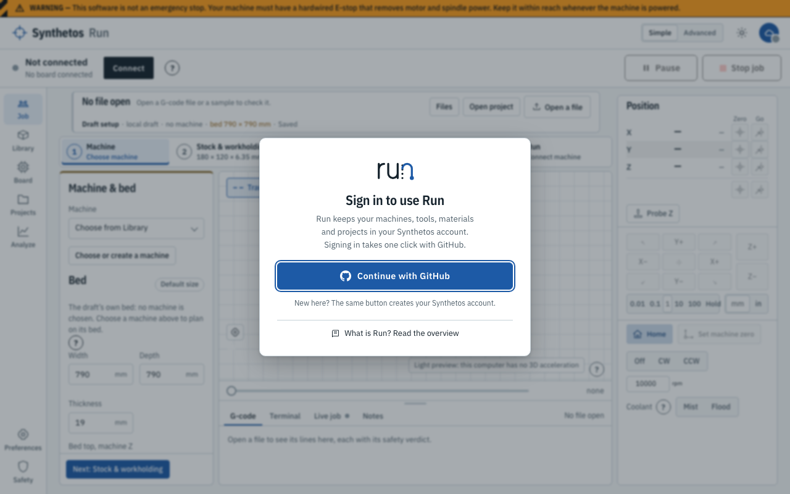
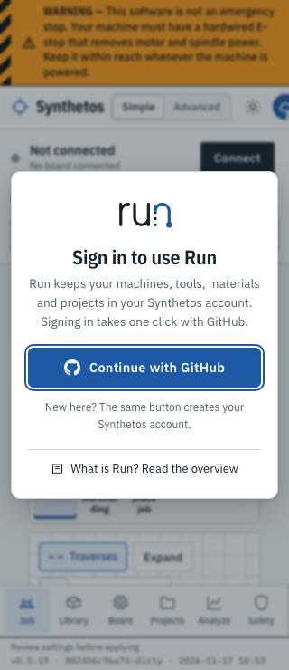
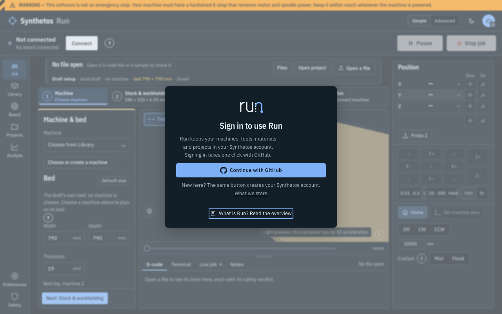
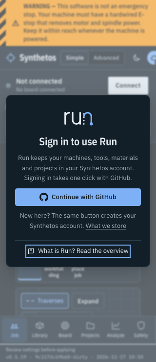

# The sign-in front door

A first-time visitor to run.synthetos.com sees the workspace, dimmed and blurred, under one dialog: the run wordmark,
"Sign in to use Run", two lines on what the account holds, one button, "Continue with GitHub", a line for newcomers,
and below a rule, "What is Run? Read the overview". A "What we store" link joins the newcomer line when accounts
publishes its privacy page. Nothing behind the dialog can be clicked, focused or reached with Tab: the whole
workspace root is `inert` while the page is locked (set on the element by an effect, because Preact's hydrate does
not diff props and a hosted page hydrates already locked). The button is a plain link to the Worker's `/auth/login`;
refusal and failure on the accounts side show the Worker's problem page, never a second dialog here. Design:
`docs/superpowers/specs/2026-11-16-first-run-design.md` §5.

## Who sees what

The gate is decided by `apps/web/src/gate/gateState.ts` from the page's account state and whether the origin is a
hosted one (`run.synthetos.com`, `staging.run.synthetos.com`):

| Session read | Non-hosted origin (bench, localhost) | Hosted origin |
|---|---|---|
| signed in | open | open |
| signed out, sign-in offered | locked, sign-in dialog | locked, sign-in dialog |
| signed out, sign-in not offered | open | locked, "Sign-in opens on this site soon." |
| checking | open | scrim only, no dialog |
| unavailable (session read failed) | open | locked, the button plus "The account service did not answer. Try again in a minute." |

The lock is what the page shows. The Worker's `authGate.ts` still decides every gated request on its own.

## Screenshots

Generated by `tools/e2e/specs/sign-in-gate.e2e.ts` with `RUN_SCREENSHOTS=1`.

| | 1280 px | 320 px |
|---|---|---|
| Light |  |  |
| Dark |  |  |

## Testing it locally

The local page (`127.0.0.1`) is a non-hosted origin, so it locks only when the session read offers sign-in. Stub the
read in a browser test:

```ts
await page.route('**/api/session', (route) => route.fulfill({ json: { account: null, signIn: true } }));
```

`{ account: null, signIn: false }` keeps the local page open; an `account` object lifts the lock. The unit tests are
`apps/web/test/gateState.test.ts`, `signInGate.test.ts` and `appShellGate.test.ts`; the browser test is
`tools/e2e/specs/sign-in-gate.e2e.ts` (dialog, focus, Tab never reaches the workspace, both themes).

The first-visit card below the machine strip was replaced by this gate on 2026-11-17, and with it the
"Copy what's in this browser to your account?" prompt: a signed-in page uses account records only.
