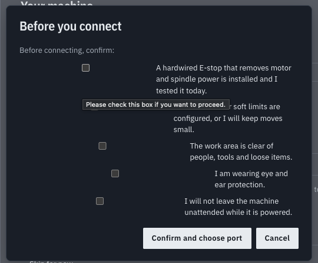
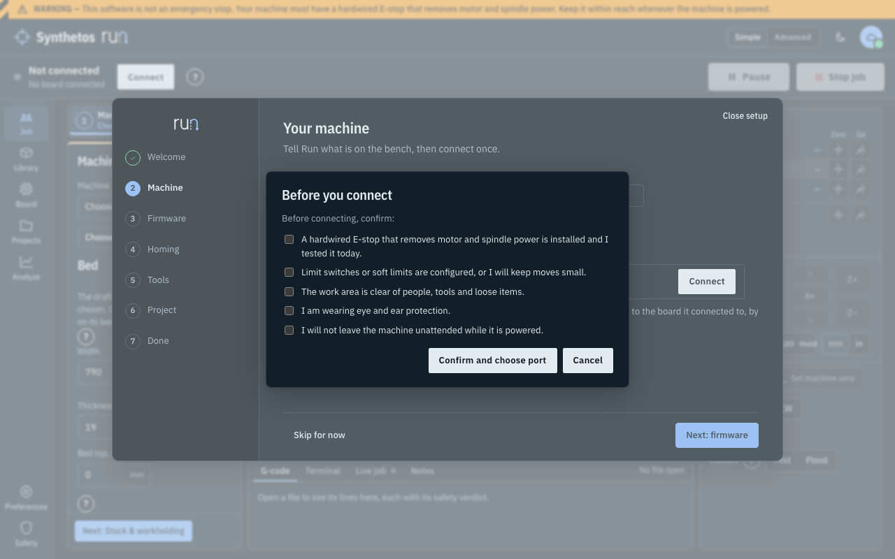
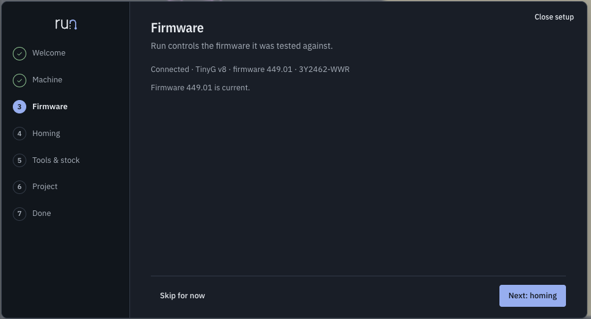
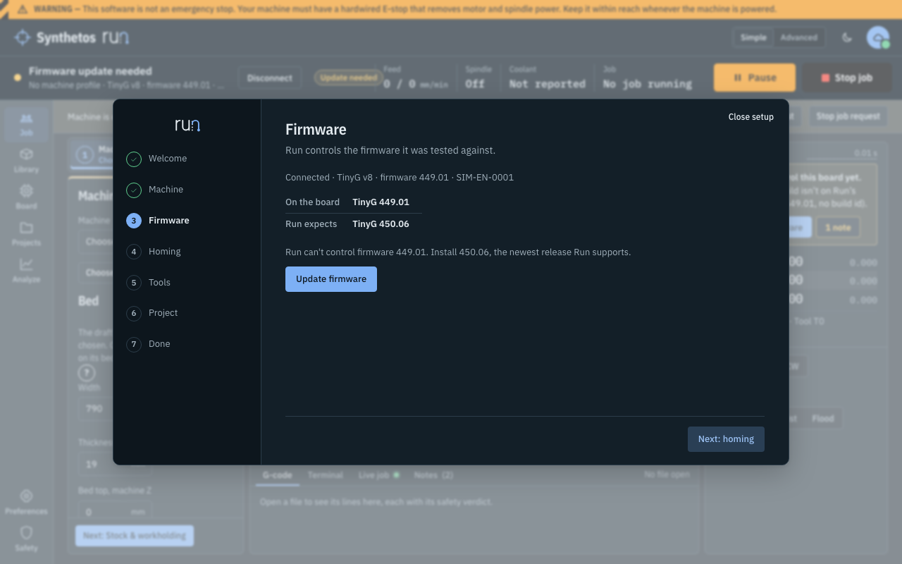
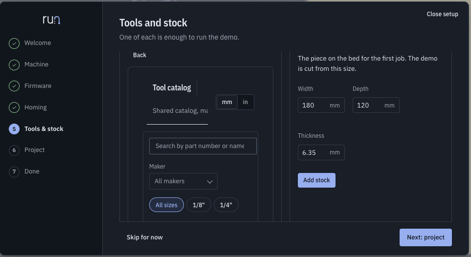
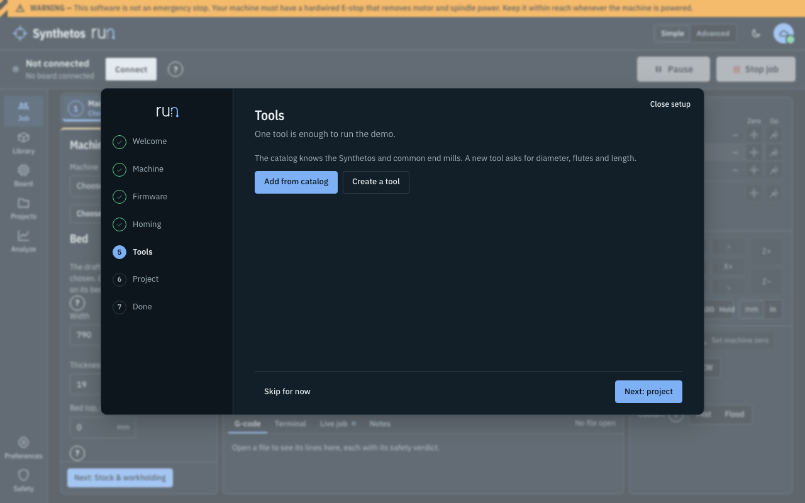
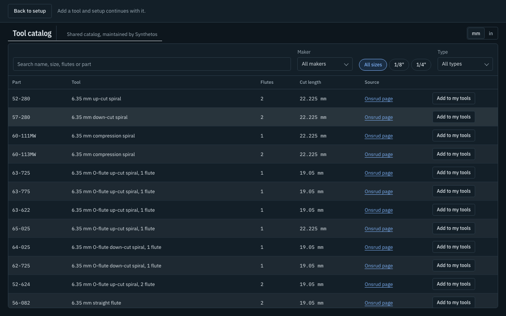
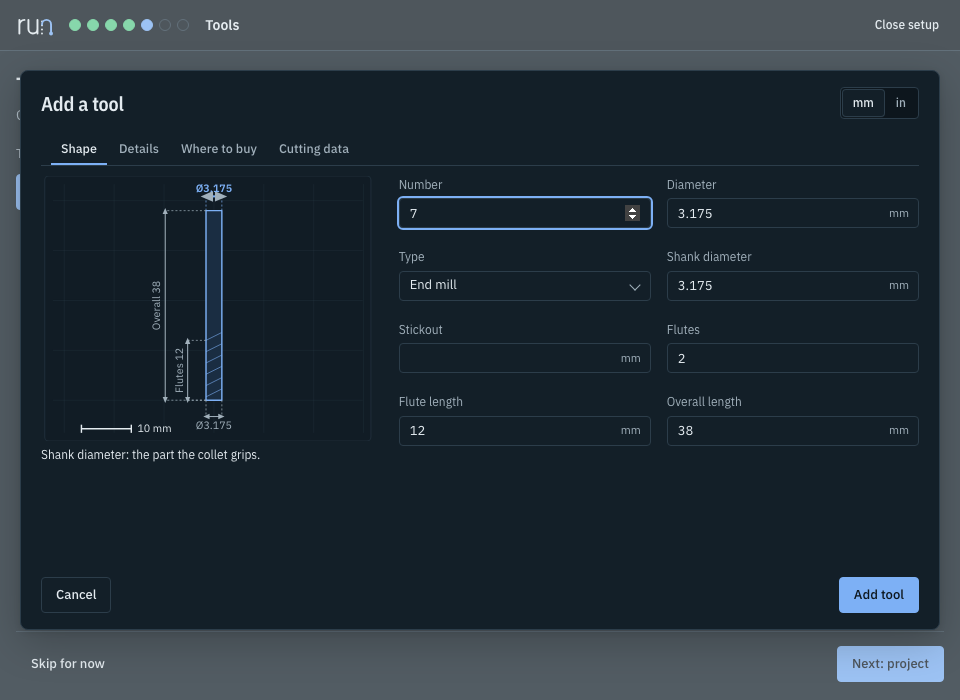
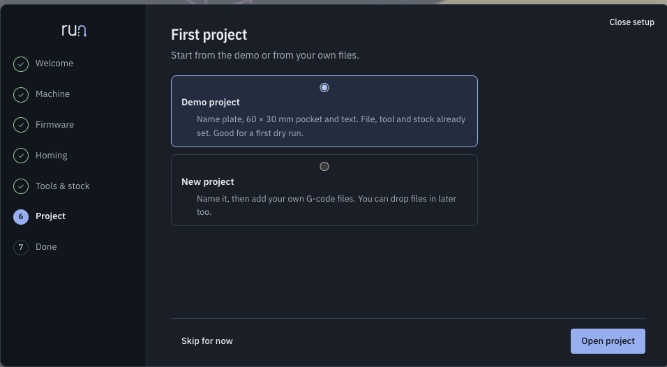
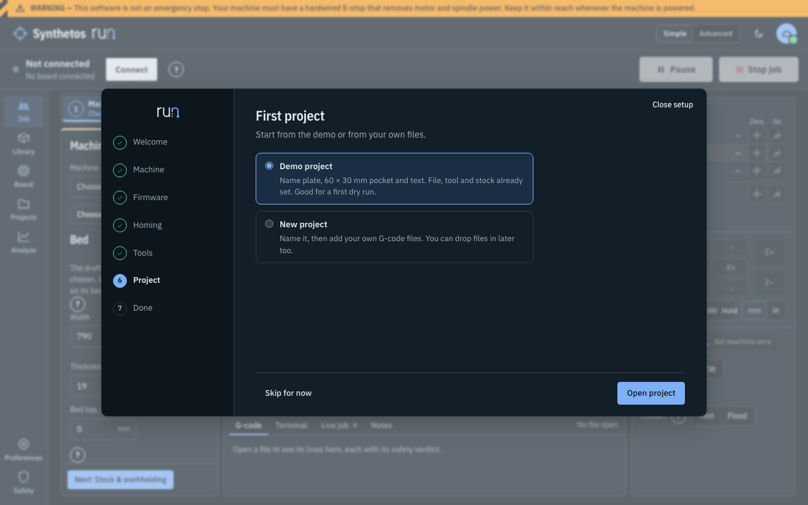

# Setup wizard fixes (owner's staging walk, 2026-11-18)

The owner walked the setup wizard on staging with a real board, in the dark theme, and rejected four screens:
“fix all of this in staging then we will take another look after it deploys”. Each section below has the owner's
picture, the same screen after the fix, what was wrong and why. The new pictures are from the fake-serial stand-in
(simulated board, stubbed account); no bench hardware was used. Plan and rulings:
`docs/superpowers/plans/2026-11-18-wizard-fixes.md`. The full walkthrough is `docs/design/SETUP_WIZARD.md`.

## 145: the "Before you connect" checklist inside the wizard

Owner: “this looks like junk. fix.”

| Owner, staging | After |
|---|---|
|  |  |

**What was wrong.** The checkboxes floated in the middle of each line, the text sat to their right at a different
place on every line, and the dialog was cut off by the wizard frame.

**Why.** The wizard mounts beside the app's root element, not inside it. The shared stylesheet gives every `input` a
full width and padding, and only the app's root resets checkboxes and radios back to their natural size. Inside the
wizard each checkbox stretched across its line, so its box sat in the middle of a wide empty input. The C1 dialog's
backdrop is positioned against its nearest positioned ancestor, which inside the wizard is the frame, and the frame
clips what overflows it.

**Fix.** The app's base input rules now name the wizard beside the app, so checkboxes and radios are their natural
size there too. A dialog the wizard hosts covers the whole page above the frame. The frame no longer borrows the
shared dialog class, and every wizard rule names a wizard-owned class, so nothing in the wizard's stylesheet reaches
into the dialogs and app parts it hosts. A browser test measures the checklist inside the wizard at 1280 and 960 in
both themes: each checkbox is at most 20 px wide and left of its text, every line's text starts at the same place,
the dialog is inside the viewport and on top. C1 itself cannot be reached on the local page (the safety advisory
refusal comes first), so the test places the checklist's exact markup where Connect puts it, and a unit test pins
that markup to the real component.

## 146: firmware 449.01 called "current"

Owner: “nope not current why did this say this?!”

| Owner, staging | After (simulated board on 449.01) |
|---|---|
|  |  |

**What was wrong.** The step said "Firmware 449.01 is current" while the newest release Run supports for that
hardware is 450.06, and 449.01 is below what Run controls.

**Why.** The step asked the update offer and treated every "no offer" as "current". The offer stays quiet for many
reasons that have nothing to do with being current: the release list has not loaded, the site has no updater, the
board is not at rest, an overlay is up, the session is read-only, a job is loaded.

**Fix.** The step now judges the board against the verified release list itself, with the same rules the offer uses
(`firmwareStanding` and `newestRelease` in `firmware/updateOffer.ts`). The offer only decides whether the update can
run from the wizard right now. The states are checking, list failed, needed, available, not listed and current.
"Current" appears only when the list is loaded and names nothing newer for this hardware. When a newer release
exists but the update cannot run now, the step keeps the "On the board / Run expects" table and says why in one line:
the machine is not idle, the connection is read-only, or this site has no updater. Unit tests cover each state,
including 449.01 against a list whose newest is 450.06.

## 147: the catalog squeezed into the frame, and stock in the wizard

Owner: “add from catalog looks terrible its inside of the modal just awful. maybe it should show the whole page modal
for the catalog the user selects it then adds it then it goes back to the setup wizard, also you have to search by a
pn to find anything this is terrible. adding stock does not ask what material it is? not really show it we are
setting up the machine not the job i think”

| Owner, staging | After: step 5 | After: the catalog page |
|---|---|---|
|  |  |  |

**What was wrong.** The catalog opened inside the left card of a two-card row in the frame. Its filters filled the
card and the list of tools sat below the fold, so it looked as if only a part-number search found anything. The
search box said "Search by part number or name", and the search only matched maker, part number, type and the
description. Beside it, a stock card asked for sizes without a material, in a wizard that sets up the machine.

**Why.** Step 5 embedded the Library's catalog component in the frame's body as it was. The catalog search was a
plain substring match on four fields.

**Fix.** Stock is out of the wizard (OD-42): step 5 is "Tools", the wizard no longer writes stock to the setup record
(older records with one still read), new draft jobs take the seed stock, and the demo keeps its own 180 × 120 ×
6.35 mm MDF. "Add from catalog" opens the catalog as a whole page over the wizard in its normal layout, with "Back to
setup" on top. Adding a tool closes the page and the step shows it. The catalog lists every tool with no search. The
search now takes every word you type and matches name, type, diameter in millimetres or as an inch fraction, flute
count ("2 flute") and part number; that change is in the catalog component, so the Library has it too. "Create a
tool" opens the tool editor above the frame.

| Create a tool at 960, dark |
|---|
|  |

## 148: radios in the middle of the cards

Owner: “this looks terrible radios inside of the middle of the buttons.”

| Owner, staging | After |
|---|---|
|  |  |

**What was wrong.** In First project and Homing the radio sat on its own line, centred above the card's title.

**Why.** The same cause as 145: outside the app's root the radio kept the shared full-width input rule, so it took a
whole line and its circle sat in the middle.

**Fix.** The base input rule fix, plus one wizard radio card (`PickCard.ts`) used by both steps: the radio at the
left, level with the title, the title and description left-aligned beside it, at most 440 px wide. A browser test
checks those positions at 1280 and 960 in both themes.

## Also found on the walk

Every step was walked in both themes at 1280 and at 960 with the board connected. A browser test now checks each step
for sideways overflow, centred text and stretched checkboxes or radios.

- **Step 4, Set machine zero.** The control kept the Job page inspector's side padding and sat indented from the
  cards above it. It now lines up with them.
- **Step 1, the list.** Without the app's list styling the three lines sat indented with no marks. They now have
  bullets.
- **Step 5, a resumed wizard.** A wizard that resumed directly on step 5 never noticed a newly added tool, so the step
  did not show it. The step now records the tool list it opened with.
- **Dialogs the wizard hosts.** The tool editor and the catalog's preview and add dialogs had the same clipping cause
  as C1. They now cover the page above the frame.
